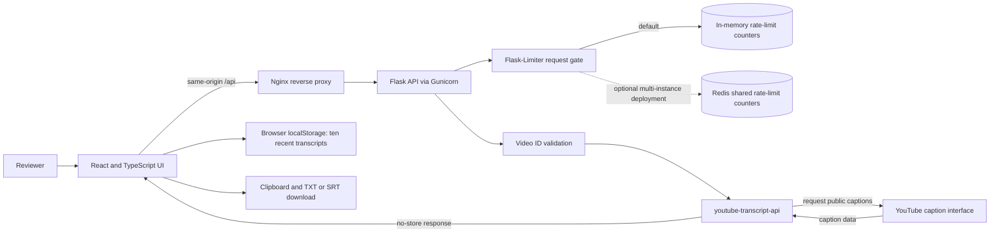

# YouTube Transcript Extractor

A privacy-conscious full-stack application for retrieving, searching, navigating, and exporting available public YouTube captions.

Built with React, TypeScript, Flask, Python, and Docker, the project combines a browser-based interface with a hardened API, automated testing, CI, rate limiting, CORS controls, input validation, and production deployment configuration.

## Business Problem Solved

Reviewing long public videos is slow when the useful information is buried in captions. This application makes available captions searchable and exportable, with timestamps that take the reviewer back to the source. It separates an interactive browser workspace from a small, validated API so the UI and caption retrieval can be tested and deployed independently.

### Persona pain points

- **Researchers and analysts:** Relevant statements can be difficult to locate inside long videos.
- **Content and sales teams:** Reusing public-caption material requires a searchable, timestamped handoff rather than repeated manual playback.
- **Technical reviewers:** A demo is harder to evaluate when its frontend, upstream dependency, rate limits, and failure modes are hidden.

### Business value and ROI boundary

Search, timestamp navigation, and export reduce repetitive review work and make findings easier to trace back to the source video. The repository does not claim a measured productivity gain or guaranteed caption coverage; both depend on the review workflow and YouTube's available caption tracks.

### System invariants

- The API accepts validated YouTube video identifiers and returns safe client errors.
- Transcript responses use `Cache-Control: no-store`; the server does not cache transcript content.
- Recent transcript history stays in the current browser's local storage and can be cleared by the user.
- Rate limiting is always enabled. Redis may store shared rate-limit counters, but never transcript data.
- Caption retrieval depends on public availability and YouTube's upstream interface.

## Architecture



The Docker setup runs the static UI and reverse proxy in one container and the API in another. The API uses in-memory rate-limit counters by default; it does **not** cache transcripts or use a database. Redis is an optional shared **rate-limit storage** backend for a separately configured multi-instance deployment, not an implemented transcript cache.

## Evaluator quickstart

Install Docker Engine with Compose v2 (or Docker Desktop), then run from the repository root:

```bash
docker compose up --build --wait
curl --fail http://localhost:3000/api/health
```

Open `http://localhost:3000`. No API key, account, or environment-file copy is needed. The first build downloads dependencies and can take several minutes. Ports bind to loopback; the API is reached through Nginx rather than exposed directly. If port 3000 is busy, use `FRONTEND_PORT=3001 docker compose up --build --wait` and open port 3001.

```bash
docker compose down
```

The health check verifies local service readiness without calling YouTube. This local demo shares the API's rate-limit bucket across requests from the Nginx proxy. Production deployments need an explicitly trusted proxy configuration and shared rate-limit storage before scaling. Actual caption retrieval still depends on caption availability and YouTube's upstream restrictions. See [Important limitations](#important-limitations).

## What it demonstrates

- Full-stack application architecture across React/TypeScript and Python/Flask
- API design, input validation, error handling, and client/server integration
- Security-conscious implementation with CORS restrictions, rate limiting, headers, and safe client errors
- Automated frontend and backend testing with GitHub Actions
- Docker-based API packaging and production deployment configuration
- Iterative AI-assisted development followed by technical review, hardening, testing, and documentation

## Features

- Accepts standard YouTube links, `youtu.be` links, Shorts, Live, embeds, and raw video IDs.
- Retrieves creator-supplied or auto-generated caption tracks without a YouTube API key.
- Searches transcript text in the browser and jumps the privacy-enhanced video embed to any caption.
- Copies plain or timestamped text and exports UTF-8 TXT or SRT files.
- Keeps the ten most recent transcripts in local browser storage with a one-click clear action.
- Includes input validation, request-size limits, origin-restricted CORS, rate limiting, safe client errors, security headers, and production WSGI configuration.

## Repository layout

```text
.
├── archive/gemini/         # Prototype reference with safety edits; never deployed
├── backend/               # Flask API, Python dependencies, and tests
├── docs/                  # Original project brief and review notes
├── frontend/              # Vite + React + TypeScript application
├── .github/workflows/     # CI checks for both stacks
├── docker-compose.yml     # Local two-service evaluator environment
├── CONTRIBUTING.md
├── SECURITY.md
└── LICENSE
```

## Prerequisites

- Python 3.10 or newer
- Node.js 24 (matching CI and the frontend container)
- npm

## Local setup

### 1. Start the API

```bash
cd backend
python3 -m venv .venv
source .venv/bin/activate
python -m pip install -r requirements-dev.txt
python app.py
```

The API listens on `http://127.0.0.1:5000`. Do not use Flask’s development server for public hosting.

### 2. Start the frontend

In a second terminal:

```bash
cd frontend
npm ci
npm run dev
```

Open `http://localhost:5173`. Vite proxies `/api` calls to the local Flask server.

## Configuration

Backend environment variables:

| Variable | Default | Purpose |
| --- | --- | --- |
| `ALLOWED_ORIGINS` | Local Vite origins | Comma-separated frontend origins allowed by CORS |
| `TRANSCRIPT_RATE_LIMIT` | `20 per hour` | Per-client transcript request limit |
| `RATELIMIT_STORAGE_URI` | `memory://` | Flask-Limiter storage; use Redis for multi-instance hosting |
| `PORT` | `5000` | Local development port |
| `LOG_LEVEL` | `INFO` | Python logging level |

Frontend environment variables:

| Variable | Default | Purpose |
| --- | --- | --- |
| `VITE_API_BASE_URL` | Same origin | Public base URL of the deployed Flask API |

Copy the relevant `.env.example` file before changing values. Never commit secrets. This project needs no API key.

## Tests and release checks

```bash
# Backend
cd backend
python -m pytest
ruff check .
pip-audit -r requirements-prod.txt

# Frontend
cd frontend
npm test
npm run build
npm audit --audit-level=high
```

GitHub Actions runs these checks on pushes and pull requests, plus a Docker Compose build and HTTP smoke test covering health, rejected input, static assets, and client-side routing.

## Production notes

Build the frontend with `npm run build` and host `frontend/dist` on a static host. Run the API behind HTTPS with a production WSGI server. A container entry point is included:

```bash
cd backend
docker build -t youtube-transcript-api .
docker run --rm -p 8000:8000 \
  -e ALLOWED_ORIGINS=https://your-frontend.example \
  youtube-transcript-api
```

For multiple API instances, point `RATELIMIT_STORAGE_URI` at a shared Redis service. Set `VITE_API_BASE_URL` at frontend build time to the public API origin.

## Important limitations

This project uses the third-party [`youtube-transcript-api`](https://github.com/jdepoix/youtube-transcript-api), which relies on an undocumented YouTube web-client interface. YouTube can change or block that interface, and cloud-hosting IPs are frequently blocked. Private, age-restricted, caption-disabled, or unavailable videos may not work.

Only retrieve and reuse transcripts when you have the right to do so. Follow YouTube’s terms, creators’ rights, and applicable copyright and privacy rules. This repository is not affiliated with or endorsed by YouTube or Google.

## Privacy

The app sends the video ID to the configured Flask API, which requests captions from YouTube. Transcript history is stored only in the current browser’s local storage. It can be cleared from the History screen. The repository includes no analytics, accounts, cookies, advertising, or tracking code.

## Development approach

The initial concept and source prototype were created through an AI-assisted development workflow using Gemini Canvas. The files in `archive/gemini/` retain that provenance with documented, targeted safety edits. The original imported versions remain in Git history for comparison.

The production repository extends that prototype with a complete frontend scaffold, hardened API behavior, dependency controls, automated tests, CI, production deployment guidance, security documentation, and additional validation.

See [`docs/GEMINI_PROJECT_BRIEF.md`](docs/GEMINI_PROJECT_BRIEF.md) for the original project brief.

## License

[MIT](LICENSE)
